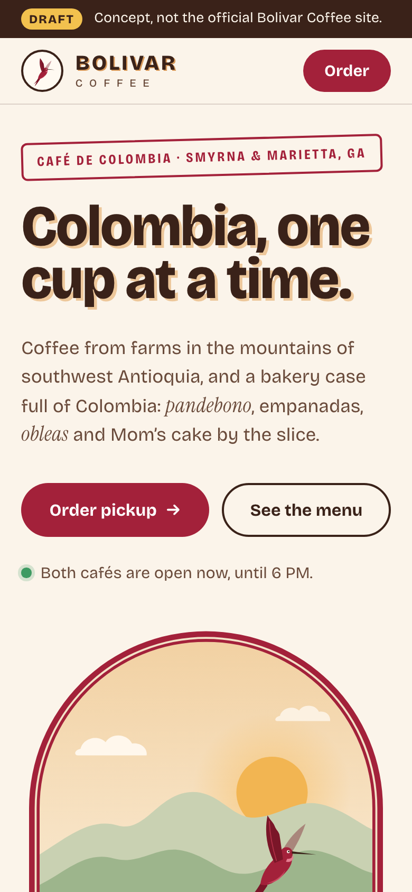
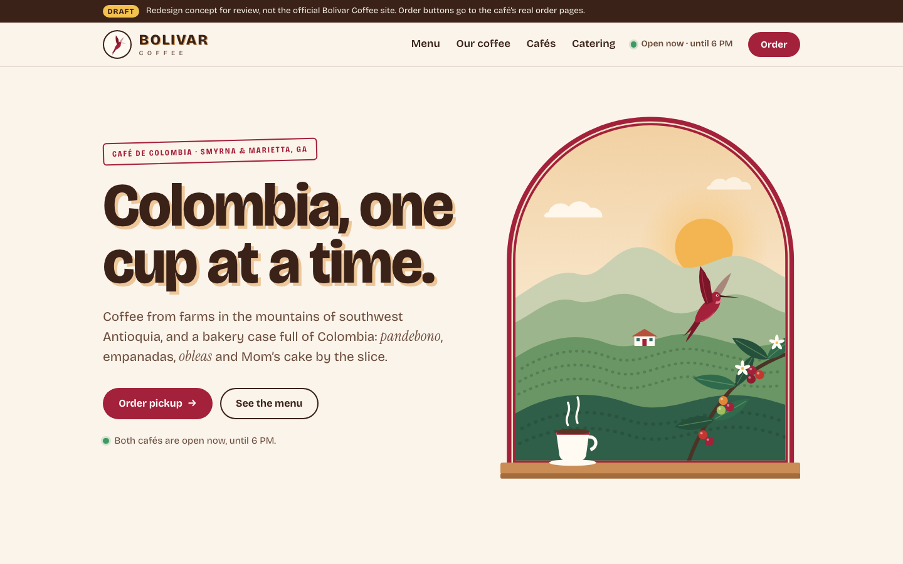

# Bolivar Coffee: website redesign draft

A one-page redesign concept for Bolivar Coffee, the Colombian café with two shops in Cobb County, Georgia: Smyrna (4480 S Cobb Dr SE, Suite W) and Marietta (1651 Powder Springs Rd SW, Suite 1). Their current site is bolivarcoffee.com.

**Status: draft for review.** Preview: https://evanmcdowell31.github.io/bolivar-site/ (GitHub Pages, from `docs/` on `main`). Every view shows a draft banner, and `noindex` keeps it out of search engines. It is not the café's official site. The order buttons go to the café's real order pages on bolivarcoffee.com.

| Phone | Desktop |
| --- | --- |
|  |  |

More in `review/`: the menu, the origin map, the cafés, the order chooser, and both full pages.

## The idea

"Colombia, one cup at a time" is the café's own line, so the page leads with it. Beside it, an arched window, painted in the hummingbird's crimson, looks out on the coffee hills of southwest Antioquia, where their beans grow: green ridges at sunrise, rows of coffee, a white farmhouse, a branch of ripening cherries, a hummingbird, and a cup on the sill.

The look comes from their logo: a crimson hummingbird, BOLIVAR in heavy brown capitals with an offset shadow, and gold coffee sprigs, on cream. The hummingbird here is a new drawing after theirs, so swap in their own logo files. The type is Bricolage Grotesque, heavy for headings (with the logo's offset shadow) and plain for text, and Instrument Serif italic for Spanish words, quotes and the section labels. Both are served from `docs/fonts/` under the SIL Open Font License (license files alongside), so the page loads nothing from other servers.

## What's on the page

- "Open now" in the header and on each café, worked out from their hours in Georgia time. Today's hours are marked.
- One **Order** button that asks which café, then opens that café's real order page.
- The menu as a café board: from the bar, the bakery case and the kitchen, with prices and gluten-free marks from their online menu.
- "New to Colombian food? Start here": pandebono, empanada, arepa, oblea, arequipe and aguapanela, each drawn, with how to say it and what it is. On phones these swipe sideways.
- Their origin story brought forward: southwest Antioquia, the founder's words, 12 oz bags to take home, and the school in Colombia that each bag helps. A map draws the 2,000 miles from the farms to Cobb County.
- Both cafés side by side, with directions (Google and Apple Maps), tap to call, and one hours table.
- Catering through ezCater, the picnic box, Bolivar Rewards and the app.
- Three short quotes from the reviews on their site.
- On phones, an Order and Find a café bar appears once the top buttons scroll away.

## What it fixes on the current site

- **The location pages are swapped.** bolivarcoffee.com/marietta shows the Smyrna page, and /smyrna shows Marietta's. The order pages are crossed the same way: /menu/marietta orders from Smyrna. The draft's buttons follow the live slugs as they are today (Marietta orders at /menu/smyrna), so swap them back if the café fixes theirs.
- The story (Antioquia, the founder, the school) sits below stock lines such as "Delicious Food, Done Right". Here it leads.
- The Colombian food that sets them apart had no explanation for newcomers.
- A "VISIT US TODAY!" ticker repeats a dozen times, and prices live only on the order pages.

## Preview and screenshots

```sh
python3 -m http.server -d docs 8000   # open http://localhost:8000
node tools/shoot.mjs                  # re-renders review/*.png and docs/og.png
```

Add `?still` to the address to stop the motion, and `?order` to open the café chooser. The screenshots use them. `tools/shoot.mjs` drives Playwright's cached headless Chromium shell, with no window.

The map's outlines come from Natural Earth, simplified by `tools/map.py` (`python3 tools/map.py NE_DIR` prints the paths for `ne_50m_admin_0_countries.geojson` and `ne_110m_admin_1_states_provinces.geojson` in NE_DIR).

## Before it could go live

- [ ] The café's logo files and their own photos of the food and the shops, alongside or instead of the drawings.
- [ ] Confirm prices and items. They come from the Marietta online menu on 9 November 2026. Smyrna's prices differ a little, and its online menu lacks the pandebono, empanadas, pastel de espinaca and Colombian breakfast.
- [ ] Confirm the play area at Marietta (from reviews on their site) and the founder's quote, which is lightly edited ("worked by agriculture people" became "worked by people").
- [ ] Ask where the name comes from. Ciudad Bolívar is a coffee town in southwest Antioquia; if that's the source, the story could say so.
- [ ] Their ordering, rewards and app run on Owner.com, so a new front page would keep those and link to them.
- [ ] Remove the draft banner and `noindex`, and add schema.org `CafeOrCoffeeShop` data for both cafés.

## Sources

- Menu, prices, hours, phones, the story, the foundation, reviews and links: bolivarcoffee.com (home, /marietta, /smyrna, /menu/marietta, /menu/smyrna, /story), read 2026-11-09.
- Addresses and suites: Yelp, DoorDash and MapQuest listings, and the US Census geocoder, read 2026-11-09.
- Logo and colours: the logo on bolivarcoffee.com, used only as a reference and not copied into the site.
- Map: Natural Earth 1:50m countries and 1:110m states (public domain), github.com/nvkelso/natural-earth-vector.
- Fonts: Bricolage Grotesque and Instrument Serif, Google Fonts, SIL Open Font License 1.1.
